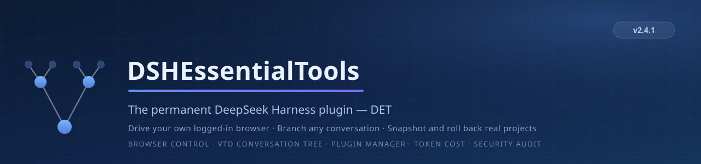

<p align="center">
  
</p>

<p align="center">
  <b>DET · dsh-essential-tools</b> — the plugin that turns DeepSeek Harness into a usable engineering cockpit.<br>
  <b>Let the AI drive your own logged-in browser</b> · <b>Branch, edit and retry any conversation</b> · <b>See a picture precisely, not approximately</b> · <b>Pay only for the tools this turn actually uses</b>
</p>

<p align="center">
  <a href="LICENSE"></a>
  
  
  
  
  
</p>

<p align="center">
  <a href="#-quick-start-60-seconds"><b>Quick start</b></a> ·
  <a href="#-alv--seeing-a-picture-precisely"><b>ALV</b></a> ·
  <a href="#-adu--paying-only-for-what-you-use"><b>ADU</b></a> ·
  <a href="#-feature-map"><b>Feature map</b></a> ·
  <a href="docs/GUIDE.md"><b>用户指导手册</b></a> ·
  <a href="CHANGELOG.md"><b>Changelog</b></a> ·
  <a href="docs/SECURITY.md"><b>Security</b></a>
</p>

---

> **中文一句话**：DET 是 DSH 的永久插件 —— 让 AI 开你自己已登录的浏览器、任意消息开分支改问、跑/快照/回退真工程、管所有插件与每一笔 token；2.10 起再加两件事：**ALV** 给图片造坐标系（栅格·辅助线·边线坐标·本机 OCR），**ADU** 让工具按需装载（启动只装 5 个元工具）。

## 😤 The problem

If you hack on real code with an AI agent in the loop, you already know these five:

| Pain | What everyone does today | What DET does |
| --- | --- | --- |
| 🧠 **One wrong turn kills the thread** — you want to re-ask from message #12, not start over | Copy-paste into a fresh chat and lose all context | **VTD**: edit / retry **any** message → a real hidden branch, switch back with `<N>`, and the **workspace code rolls back with you** |
| 🌐 **The AI can't see or click what you see** — your logged-in dashboards, internal pages, `file://` pages | Screenshot, paste, hand-hold, retry | **DET Browser Extension**: the model drives **your already-logged-in Edge/Chrome** through a localhost bridge you gate yourself (off / read / write / on) |
| 👁 **"I think the number is 41.00 but the crop is blurry"** — vision models guess coordinates | Re-ask, re-screenshot, hope | **ALV**: grids, rulers, guide lines, edge positions and on-device OCR with per-word boxes — *then* let the model look |
| 🛠 **Build-run-look-check is a manual loop** | Alt-Tab to the IDE and terminal 40 times an hour | Right toolbar: **▶ run · 🗎 file tree + preview/edit · 🕘 program snapshots & rollback** |
| 💸 **You have no idea what a session costs** — or which tools cost you context | Find out at the end of the month | Live **balance + per-model price + per-turn cost**, plus **ADU**: only the tools this turn needs are in the schema budget |

DET (the plugin `dsh-essential-tools`) is the **permanent** DeepSeek Harness plugin that fixes all five — and adds a full **plugin manager**, a **conversation-memory layer**, and a **security audit** on top. It lives in your `web` profile, survives restarts, and shows up in **Settings → Plugin inventory**.

> 🎁 **Zero config:** without project paths, every conversation / token / plugin / image feature works out of the box. Add paths only when you want ▶ run.

---

## 🆕 What 2.10 changed

Three answers to three long-standing problems:

| Problem | Answer |
| --- | --- |
| A vision model looks at *a picture*, not *a coordinate system* | **ALV** — 8 tools that build the scaffolding: grid, ruler, guide lines, edge positions, on-device OCR, tiling, annotation, enhancement |
| Every turn paid for 30+ tool schemas while using one or two | **ADU** — boot with 5 meta tools, mount modules on demand (`adu_list` → `adu_describe` → `adu_load`) |
| Failures only produced one word: `browser-timeout` | **Per-command budgets + structured failures + a failure ledger** (`_diagPush` → `detHealth` panel) |

A real ALV round trip, on a table screenshot:

```text
alv_info   → 900×600, RGB, mean 241, dark 3.9%
alv_edges  → horizontalPositions: y=81(4) y=141(4) y=201(4) y=261(4) y=321(4) y=381(4)
alv_grid   → cell=60, guides drawn at y=470/540, x=430 → returns gridded copy + toSource mapping
alv_ocr    → 型号数量 / ALV-100 12 18.50 222.00 / … / TOTAL 471.00   (with per-line boxes)
alv_annotate→ 2 boxes + 1 cross drawn at exact coordinates, saved and re-read
```

## 🔍 ALV — seeing a picture precisely

ALV is **geometry, not a better model**: no ML, no network, no API key. You (or the model) state coordinates and thresholds; ALV draws and measures exactly that. Everything is offline; OCR uses the OS engine (`Windows.Media.Ocr`) so results are reproducible and carry word boxes.

| Tool | What it gives you |
| --- | --- |
| `alv_info` | Size / mode / DPI / brightness / dark-pixel ratio / 16-bin histogram (optional noise). Decide *whether* to crop, upscale or binarize before wasting a look. |
| `alv_grid` | **The coordinate system itself**: grid + ruler labels in the margin + **guide lines** at any position (`guides:{horizontal:[470],vertical:[430]}`). Returns a new image and the `toSource` mapping. |
| `alv_crop` | Exact box crop, optional upscale (2–4×) for small print; omit `box` to auto-trim uniform borders. Returns the mapping back to the original. |
| `alv_edges` | **Hardcoded edge-position extraction**: Canny + probabilistic Hough → line segments *and* merged row/column positions (`horizontalPositions:[{y,votes}]`), plus an annotated copy labelled `y=` / `x=`. This is how you answer "which row line is where" without eyeballing. |
| `alv_ocr` | **Hardcoded OCR**: offline, word boxes. `mode=lines` merges glyphs into visual lines and de-spaces CJK (`型 号 数 量` → `型号数量`); `mode=cells` OCRs cell by cell and returns a **table matrix** — feed it the positions from `alv_edges`. |
| `alv_tile` | Overlapping tiles + upscale, for images with too much text to read in one look. |
| `alv_annotate` | Draw boxes / lines / arrows / crosses / circles / text at exact coordinates — show the user *where you think it is*, then verify by looking. |
| `alv_enhance` | Gray, auto-contrast, adaptive threshold, unsharp, upscale (`auto` = all of them). A blurry scan becomes legible before OCR. |

Engine ships in the package: `py/alv.py` (Pillow + numpy + OpenCV on the `python312` environment) and `py/alv_ocr.ps1` (WinRT bridge, pure-ASCII source, UTF-8 JSON out). ALV also injects a system-prompt section telling the model: *don't guess coordinates — build the scaffolding, then look again.*

## 🧩 ADU — paying only for what you use

Registering every tool up front means every request carries every schema. ADU makes loading an explicit protocol:

```text
boot        → only adu_list / adu_describe / adu_load / adu_unload / adu_status are registered
adu_list    → the module table: which tools each module brings, its cost and risk, whether it is mounted
adu_describe id=alv  → sub-capabilities, per-tool purpose, side effects, when to use it
adu_load    id=alv   → mount (same effect as flipping the switch; tools appear next turn)
adu_unload  id=alv   → unmount; the following turns get a smaller context back
```

| Module | Tools it brings | Notes |
| --- | --- | --- |
| `plugins` | 19 | global plugin library (5 tiers), GitHub install ×2, CDM, TCT, MDA, MMS — the widest permission surface |
| `browser` | 1 | `det_browser`; read / write / run, gated by the extension's tier |
| `web` | 5 | `web_inspect` / `web_act` / `web_focus` / `web_human_search` / `web_insite_search` |
| `dlt` | 6 | env table, run, build, PDF/Word/Excel/CSV read-write-convert |
| `alv` | 8 | the image suite above |
| `security`, `project` | — | always-on listeners / endpoints, not mount units |

Three rules keep it honest:

1. **The module table is the single source of truth** (`lib/adu.js`); the meta tools only validate and report — they hold no state.
2. **Mounting reuses the very same disposer pipeline** as the master switch and the UI switches, so there is never a "second state". Bookkeeping lives in `_aduGroups` (`id → [disposer]`).
3. **Turning it off is the escape hatch**: flip `ADU 按需装载` off (or set `aduBoot: "eager"`) and you are back to load-everything at boot. Master switch off removes ADU too.

## 🗺 Feature map

`Settings → DET 管理器` groups the switches by concern. Two new groups in 2.10 (identifier in parentheses):

| Group | Switches |
| --- | --- |
| **界面注入** | 文件视图 (`file`) · 运行按钮 (`run`) · 版本控制 (`ver`) |
| **对话与版本** | VTD (`vtd`) — branch / edit / retry + message micro-versions |
| **分组与插件** | MDA 分组 (`mda`) · 插件管理 (`plugins`) |
| **成本优化** | MMS 混合模型 (`mms`) |
| **DLT 集成** | 文档工具 · 右栏预览 · 环境表 · 执行与编译 · 每轮成本 · 草图导入 (`dltDocs` … `dltDraft`) |
| **识图与工具预算** 🆕 | ALV 辅助线视觉 (`alv`) · ADU 按需装载 (`adu`) |
| **安全与审批** | 代码修改审批 · AI 命令审计 · Prompt 攻击防御 (`approve` / `secCmdAudit` / `secPromptDefense`) |

Plus the **master switch** (`master`): off = stock DSH, with only this settings page (and the switch) left behind. Every switch takes effect immediately, persists in `~/.dsh/storages`, and unloads its UI along with its tools.

## 🚀 Quick start (60 seconds)

**Prerequisites** — DSH `0.2.1-rc.3+` (Web profile), Node 22+, Windows for the browser bridge / Office / OCR paths.

```powershell
# Option A — installer from the clone (recommended: installs + registers the plugin)
git clone https://github.com/LLYlab/DSHEssentialTools.git
cd DSHEssentialTools
.\install.ps1

# Option B — manual, exactly equivalent
#   1) junction the package into the profile's node_modules
#   2) add an `insert` block for id `dsh-essential-tools` in
#      ~/.dsh/profiles/web/cordis.patch.yml  (a bundle-layer install does this for you)
#   3) restart DSH, then check Settings → Plugin inventory

# Option C — straight from GitHub (no npm needed)
dsh plugin --profile web add github:LLYlab/DSHEssentialTools
```

Restart DSH, open **Settings → DET 管理器**, and you should see the switch groups, the DET toolbar on the right edge, and (in ADU mode) five `adu_*` tools in the model's tool list.

**Browser control** needs two things: install the MV3 extension from `browser-extension/`, then set **网络权限 → 使用用户浏览器** and pick a tier in the extension popup (`off / read / write / on`).

## 🏗 Architecture

```text
                      ┌──────────────────────── DSH host (Node) ────────────────────────┐
 cordis.patch.yml ──▶ │  lib/index.js  EssentialToolsService (typert Remote)             │
   (bundle layer)     │    ├─ VtdStore        conversation tree / micro-versions         │
                      │    ├─ GlobalPluginStore  5-tier plugin library + source stores   │
                      │    ├─ MdaStore        grouping / model cooperation               │
                      │    ├─ BrowserBridge   WS 127.0.0.1:9123 ◀── MV3 extension         │
                      │    ├─ DltBridge       6 dlt_* tools → py/dlt_docs.py             │
                      │    ├─ AlvBridge       8 alv_* tools → py/alv.py + alv_ocr.ps1    │
                      │    └─ AduBridge       5 adu_* meta tools → _aduGroups bookkeeping │
                      │       adapt.js (service names) · host.js (capability probe)      │
                      └───────────────────────────────┬─────────────────────────────────┘
                                                      │ typert endpoints (~80 methods)
                      ┌───────────────────────────────▼─────────────────────────────────┐
                      │  lib/client.js  (web bundle, no relative imports)               │
                      │   toolbar · VTD tabs · sidebar registry · status box · panels   │
                      └─────────────────────────────────────────────────────────────────┘
```

Design rules that this repo actually enforces with tests:

- **One table, one owner.** Feature keys live in `normalizeFeatures`; their labels/grouping live in `DET_FEATURE_GROUPS`; the client-structure suite fails if they drift apart (`每个功能键恰好归组一次`).
- **Never break the whole for one part.** Every registration goes through `safe(...)` + disposers; a single failing sub-capability cannot take the plugin down.
- **Facts vs. intent.** `globallyEnabled` is an *intent* record; the loader is the *fact*. They are reported side by side and never overwrite each other.
- **Loadable modules are not a second state.** ADU mounts through the same disposers the master switch uses.
- **Diagnostics never throw.** `_diagPush` and every probe is try/catch-wrapped; a diagnostic bug must not become an outage.

## 🔒 Permission & safety model

| Layer | Control |
| --- | --- |
| **Network** | 5 tiers (off → official API → fetch → **use your browser**). DET gates its own requests; the tier is also written into the model's system prompt. |
| **Browser** | Extension-side tiers `off / read / write / on`, enforced **in the extension** (DSH is read-only towards it). Write actions are refused in `read` mode; `write` mode strips page content from replies; `run` needs `on`. |
| **Code changes** | `approve` requires a diff preview + approval before saving or rolling back. |
| **Audit** | `secCmdAudit` runs an independent model audit on tool calls; `secPromptDefense` screens inputs (including command output) for injected instructions. |
| **Global plugins** | 5 tiers — `always` / `ai-auto` / `ai-approve` / `frozen` / `disabled`; `frozen` and `disabled` refuse every new enable, including the user's. Global plugin code runs with **the host's real permissions** — that is why tier control and the code scanner exist. |

## 🩺 Troubleshooting

| Symptom | Cause | Fix |
| --- | --- | --- |
| `browser-timeout` | Page too heavy for the command budget, or the extension is stuck | Retry with a larger `timeoutMs`; prefer `read_text` over `screenshot`; `web_focus` the tab first (background tabs are throttled by the browser) |
| `browser-disconnected` | Extension socket dropped mid-command | Reload the extension, then retry — DET now fails fast instead of waiting 45 s |
| `ext-mode-off` / `ext-read-denied-in-write-mode` | Extension tier | Open the extension popup and raise the tier |
| Tools missing after a restart | ADU is in lazy mode | `adu_list` → `adu_load <module>`, or turn `ADU 按需装载` off in DET 管理器 |
| `alv_ocr` returns empty text | Image too small / low contrast | `alv_crop scale=2..3` then `alv_enhance mode=auto`, then OCR again |
| ALV errors with "引擎不存在" | Package tree incomplete | Reinstall; `lib/alv.js` resolves `py/alv.py` relative to the package root |
| A permanent plugin "comes back" after restart | Intent vs. layer mismatch | Disable it in the **patch layer** (`disabled: true`) — the runtime flag alone is re-applied by the next composition |
| Everything vanished | Master switch off | Settings → DET 管理器 → 总开关 |

The **健康与失败诊断** panel (Settings) shows boot health, plugin-library intent↔fact mismatches, DLT/ALV/ADU mount facts, and the recent failure ledger.

## 🧪 Tests

11 suites, **534 assertions**, no profile / no network / no server required:

```powershell
node tests\unit.test.mjs              # pure functions + Config neutrality      128
node tests\host.test.mjs              # real host-half mount (fake Cordis ctx)   60
node tests\adapt.test.mjs             # service access layer + architecture guard 23
node tests\client-structure.test.mjs  # information architecture + token guard   47
node tests\client-load.test.mjs       # executes the client bundle for real      17
node tests\dlt-host.test.mjs          # DLT integration: tools/prompt/endpoints  37
node tests\dlt-integration.test.mjs   # client mounting matrix                    22
node tests\draft.test.mjs             # sketch draft: live model judgement        40
node tests\gp-state.test.mjs          # permanent-plugin intent model + guards    71
node tests\pause.test.mjs             # master-switch pause/resume scope          10
node tests\alv-adu.test.mjs           # ALV/ADU contracts + real engine runs      79
```

Run them **from inside the package** (ESM resolves the real `@deepseek-ai/*` peers there). Exit code `0` = all green.

## 📚 Docs

- [`docs/GUIDE.md`](docs/GUIDE.md) — 用户指导手册：逐功能详解、权限模型、扩展装载、FAQ
- [`docs/SECURITY.md`](docs/SECURITY.md) — 威胁模型与边界
- [`docs/DET功能.md`](docs/DET功能.md) — 功能总览
- [`ARCHITECTURE.md`](ARCHITECTURE.md) — 内部结构、约定与测试矩阵
- [`CHANGELOG.md`](CHANGELOG.md) — 每一版的「为什么」

## 🤝 Contributing

Issues and PRs welcome. Two house rules: **every new switch must be grouped** (the structure test will fail otherwise), and **every claim in the UI must have a fact behind it** — if the panel says "applied", something must have read it back.

## License

MIT — see [LICENSE](LICENSE).
